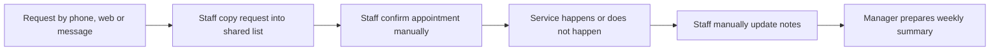
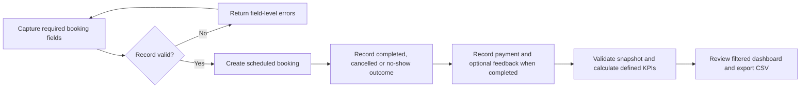

# 01 · Business Analyst — booking process and requirements

**Fictional practice scenario. Requirements and processes are proposed designs.**

## Problem and business objective

In this fictional scenario, staff receive booking requests through phone, web and messaging channels. They copy requests into a shared list, update outcomes inconsistently and prepare a manual weekly summary. The assumed problem is inconsistent booking records and unclear reporting definitions.

The proposed objective is to capture a consistent minimum booking record, make outcome changes explicit, and provide a reproducible summary. No real efficiency gain or commercial benefit has been measured. The synthetic baseline is available in `04-data-analysis/outputs/kpis.csv`.

## Stakeholders and open questions

| Scenario stakeholder | Assumed need | Question to validate in real discovery |
|---|---|---|
| Booking coordinator | Complete, valid booking details | Which fields are necessary at intake? |
| Service technician | Clear assigned appointment | How are appointments confirmed and reassigned? |
| Owner/manager | Consistent outcome and revenue summaries | Which decisions should each KPI support? |
| Customer | Clear appointment and cancellation handling | What communications and consent are required? |

## As-is process — invented current state

Possible failure points to investigate: omitted fields, ambiguous outcomes and inconsistent revenue calculations. These are hypotheses, not observed incidents.

## To-be process — proposed

## Scope

Included: booking capture, controlled outcomes, recorded payments, optional feedback, field validation, reporting definitions and a demonstration dashboard. Excluded: online payments, automatic messaging, route optimisation, staff capacity optimisation, real customer contact details and production deployment.

## Requirements and user stories

| ID | Priority | User story and acceptance criteria |
|---|---|---|
| R-01 | Must | As a coordinator, I need a valid booking record. **AC-01:** Given a known service/customer/technician, supported channel and appointment date not before creation, a valid booking is assigned an ID and `scheduled` status. Missing or invalid required fields show explanatory messages and create no record. |
| R-02 | Must | As a coordinator, I need an explicit outcome. **AC-02:** A scheduled booking can become completed, cancelled or no_show. A cancelled booking requires a reason; a completed booking requires positive actual minutes. Repeating or changing a terminal outcome is blocked; corrections require a future audited correction workflow. |
| R-03 | Must | As a manager, I need collected payments to be reported consistently. **AC-03:** A payment can be recorded only against a completed booking, as integer cents from zero up to the quoted amount. Non-completed bookings contribute zero collected revenue. |
| R-04 | Must | As a manager, I need comparable filtered summaries. **AC-04:** Service, status, channel and appointment-month filters apply before every KPI. Completion/cancellation rates exclude future scheduled bookings. Empty selections show zero counts/revenue and no percentage value. |
| R-05 | Should | As a coordinator, I need appropriate access and an update record. **AC-05:** The proposed workflow requires an authorised coordinator/manager role; status/payment changes record actor, timestamp and previous/new values. Reporting uses synthetic customer IDs, not contact details. Security and audit are design requirements, not implemented controls. |
| R-06 | Should | As a manager, I need optional service feedback without treating missing responses as zero. **AC-06:** A completed booking accepts one integer score from 1–5; feedback on other outcomes is rejected. The mean excludes blanks and shows response count. |

## Proposed evaluation

Validate the field set and workflow with actual stakeholders before implementation. For this practice project, use the pipeline's validation report, reconciliation checks and dashboard baseline tests. The project makes no claim that the proposed workflow improved a real business.
