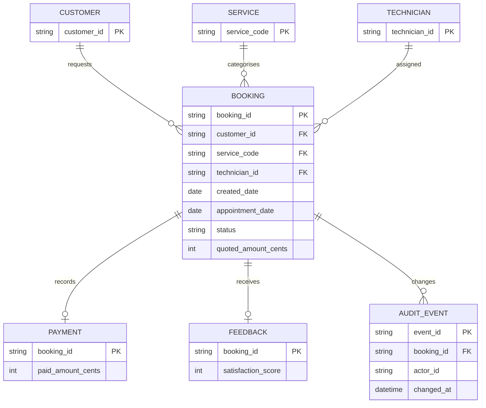

# 02 · Business Systems Analyst — translating needs into data

**Proposed logical model. Implemented analytics use a flattened synthetic CSV.**

This chapter connects business requirements to fields, validation rules, workflows and checks. The operational booking application and logical database are proposed designs.

## Proposed logical model

The practice scenario allows one aggregate payment and one feedback score per booking. A production system would need payment transactions/refunds, timezone-aware appointments, authorised correction events and more detailed scheduling. These are out of scope.

## Artifacts

- [Data dictionary](data-dictionary.csv): every raw CSV field, type, meaning and validation rule.
- [Field mapping](field-mapping.csv): proposed intake → record field → logical model → synthetic CSV.
- [Traceability](traceability.csv): requirement → workflow → specified scenarios and executed analytics checks.
- [Systems workflows](../03-systems-analysis/README.md): proposed lifecycle, transitions and exception handling.

## Business rules

1. A booking ID is unique. Customer and technician IDs are synthetic references.
2. Valid services are CLEAN, REPAIR and GARDEN. Channels are phone, web and messaging.
3. Outcomes are scheduled, completed, cancelled or no_show. Terminal outcomes are locked in the proposed workflow.
4. A completed booking requires positive actual duration. Other outcomes have no actual duration, collected payment or feedback.
5. Quotes and payments are integer cents; a payment cannot exceed its quote.
6. Optional feedback is an integer from 1–5. A blank is missing, not a zero rating.
7. Appointment date cannot precede creation. The fixed snapshot rules are explained in the shared KPI definitions.

`pipeline.py` executes CSV validation rules. The normalised model, operational transitions and access/audit controls are proposed designs with acceptance scenarios that have not been executed.
