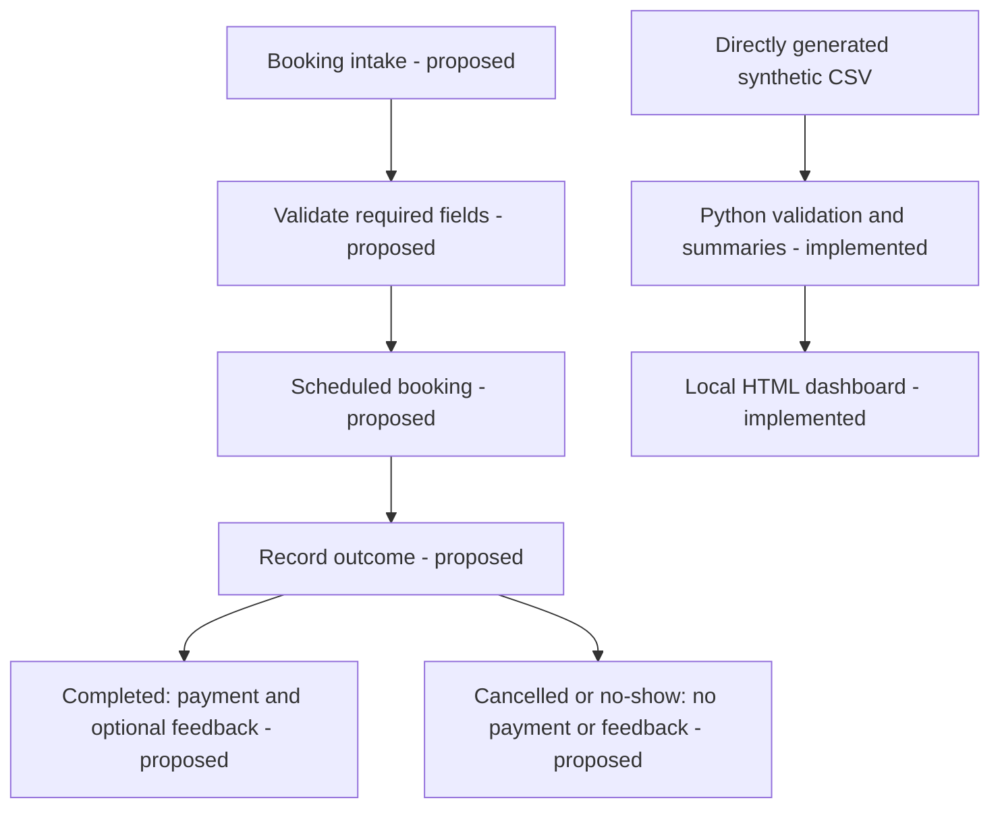
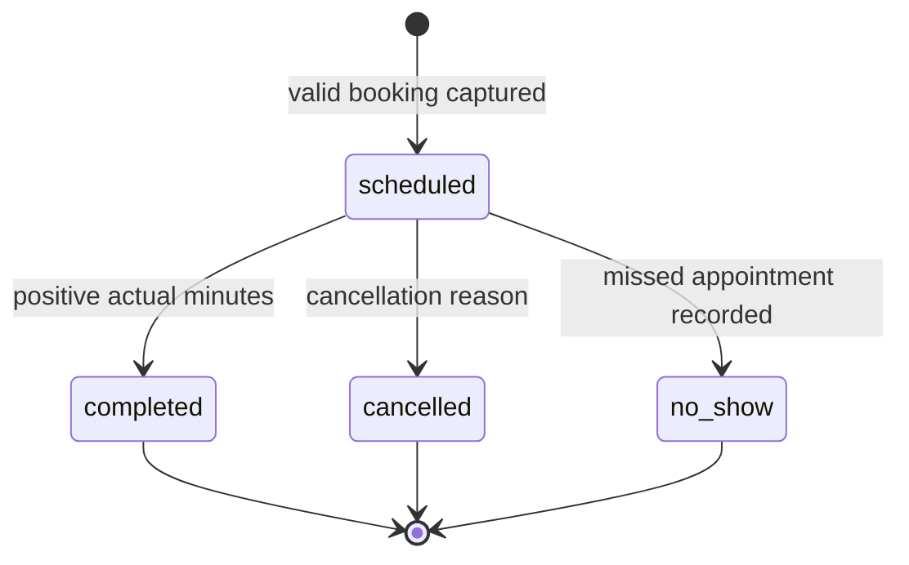

# 03 · Systems Analyst — workflows and exception handling

**Proposed operational design. Acceptance scenarios are specified and have not been executed.**

This chapter describes how booking records could move through an operational system. The booking application, database, role controls and audit trail are not implemented. The synthetic CSV is generated directly; it is not exported from an operational system. The implemented analysis begins with that CSV.

## Workflow boundary

## Proposed workflows

| ID | Workflow | Successful path | Exception handling |
|---|---|---|---|
| W-01 | Booking intake | Coordinator chooses supported service, synthetic customer/technician reference, channel, dates and quote; a valid record receives a unique ID and scheduled status. | Missing fields, unsupported values or appointment before creation block saving and show field messages. |
| W-02 | Outcome recording | An authorised coordinator changes scheduled to completed, cancelled or no_show. | Completion without positive actual minutes and cancellation without a reason are blocked. Terminal outcomes cannot be changed through the ordinary workflow. |
| W-03 | Payment recording | A completed booking records one aggregate integer-cent amount between zero and the quote. | Payment on any other outcome, fractional cents, negative amounts and overpayment are blocked. |
| W-04 | Feedback recording | A completed booking may receive one optional integer score from 1 to 5. | Other outcomes and out-of-range/non-integer scores are rejected; a missing response remains blank. |
| W-05 | Snapshot reporting | Validate the full CSV, apply filters and calculate the shared KPI definitions. | Any invalid row rejects the whole input. Empty selections show zero counts/revenue and unavailable rates. |
| W-06 | Controlled updates | Proposed coordinator/manager role checks precede updates; changes record actor, timestamp and previous/new values. | Unauthorised updates create no change. Corrections to terminal outcomes require a separately designed audited correction process. |

## Proposed status transitions

Only these forward transitions are specified. Repeated outcome updates and changes from one terminal state to another are blocked. A correction workflow is outside the current design. Payment and feedback are conditional details of completed bookings and do not create extra states.

## Acceptance scenarios and implementation status

[Acceptance scenarios](acceptance-scenarios.csv) cover valid paths, invalid input, status rules, payment boundaries, filtered reporting, access control and optional feedback. Every scenario is **specified, not run** against an operational booking application. These are reviewable design criteria, not test results.

CSV validation and reporting calculations have separate executed Python and JavaScript checks recorded in [VALIDATION.md](../VALIDATION.md). Passing those checks does not verify the proposed operational workflows, authorisation, audit trail or database.

## Design limits

The practice project uses calendar dates and one aggregate payment. Real scheduling would require timestamps, time zones and capacity rules. Refunds, payment transaction history, notifications and terminal-state corrections require further design. The fixed analytics snapshot rules classify resolved bookings on or before 31 March 2026 and future scheduled bookings after that date; they do not model a live overdue-booking queue.
